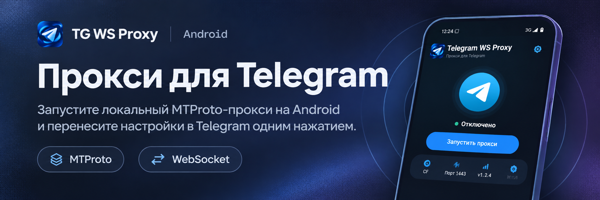
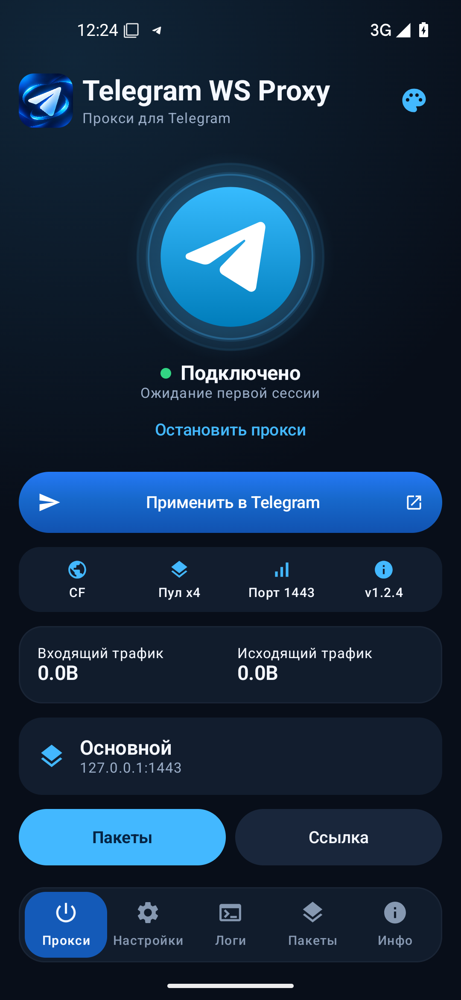

# TG WS Proxy для Android

Локальный MTProto-прокси для Telegram. Приложение запускает прокси на телефоне и передаёт настройки в Telegram. Для связи с дата-центрами Telegram движок использует WebSocket, в том числе через Cloudflare CDN.

**Mezets обновил Android-форк до v1.2.4 24.11.2026.**

[Исходный Android-порт](https://github.com/amurcanov/tg-ws-proxy-android) · [Десктопный проект Flowseal](https://github.com/Flowseal/tg-ws-proxy)

## Что изменилось в форке

- **Восстановили подключение Telegram.** Старая Android-сборка перестала подключаться у Mezets. В Android-версию перенесли исправление резервного TCP-подключения из [десктопного релиза Flowseal v1.12.0](https://github.com/Flowseal/tg-ws-proxy/releases/tag/v1.12.0). Прокси выполняет одну попытку TCP-подключения к одному адресу за раз и увеличивает паузу после неудачных попыток. В проверке Mezets Telegram снова работал через прокси.
- На главном экране видны статус, активный профиль и счётчики трафика. Когда локальный прокси запущен, вокруг круглой кнопки Telegram появляются волны.
- В настройках и профилях локальный адрес прокси задаётся в формате IPv4, например `127.0.0.1`. При импорте профиля его локальный адрес тоже проверяется.
- Профили собраны во вкладке **«Пакеты»**. Их можно импортировать из файла или ссылки, редактировать и экспортировать. При экспорте секретный ключ можно исключить.
- Редактор темы доступен на главном экране, в настройках и в разделе **«Инфо»**. Автозапуск настраивается в разделе **«Настройки»**.
- В журнале можно фильтровать события по уровню и сохранять логи с маскировкой чувствительных данных.

## Как подключить Telegram

1. Установите APK для вашего устройства. Если телефон на ARM и вы не знаете его разрядность, выберите сборку Universal.
2. Откройте TG WS Proxy и нажмите круглую кнопку Telegram на главном экране.
3. После запуска нажмите **«Применить в Telegram»** и подтвердите добавление прокси в Telegram.

## Сборка APK на Windows

Понадобятся JDK 17, Android SDK с платформой API 35, Android NDK и Rust через rustup.

1. Распакуйте исходники и запустите [build_apk.bat](build_apk.bat). Скрипт соберёт нативные библиотеки через Cargo и запустит Gradle.
2. Заберите APK из `app/release/`. Universal включает обе ARM-архитектуры. Отдельные сборки доступны для `arm64-v8a` (Android 7.0+) и `armeabi-v7a` (Android 5.0+).

Если NDK установлен в отдельной папке, задайте путь к нему в `ANDROID_NDK_HOME`. Для установки поверх существующей версии нужен тот же ключ подписи. Параметры подписи задаются в локальном файле `local.properties` через `KEYSTORE_FILE`, `KEYSTORE_PASSWORD`, `KEY_ALIAS` и `KEY_PASSWORD`. Храните файл и ключ локально.

## Сайт

Исходники сайта лежат в папке [docs](docs).

Анимации сайта вдохновлены компонентами React Bits. [Dither](https://reactbits.dev/backgrounds/dither) · [Specular Button](https://reactbits.dev/components/specular-button) · [Spotlight Card](https://reactbits.dev/components/spotlight-card)

Первый экран оформлен с использованием приёмов [unslop от Damir Sokolovsky](https://heydamir.design/unslop).

Шрифт [Golos Text](https://github.com/googlefonts/golos-text) подключён локально. [Лицензия SIL OFL](docs/assets/fonts/OFL.txt).

## Авторы и лицензия

- **Mezets** — обновление Android-форка и оформление сайта.
- **amurcanov** — [оригинальный Android-порт](https://github.com/amurcanov/tg-ws-proxy-android).
- **Flowseal** — [оригинальный TG WS Proxy для ПК](https://github.com/Flowseal/tg-ws-proxy).

Android-форк распространяется по [GPLv3](LICENSE). Код оригинального проекта Flowseal распространяется по MIT. Уведомление об авторских правах сохранено в [LICENSE](LICENSE).
